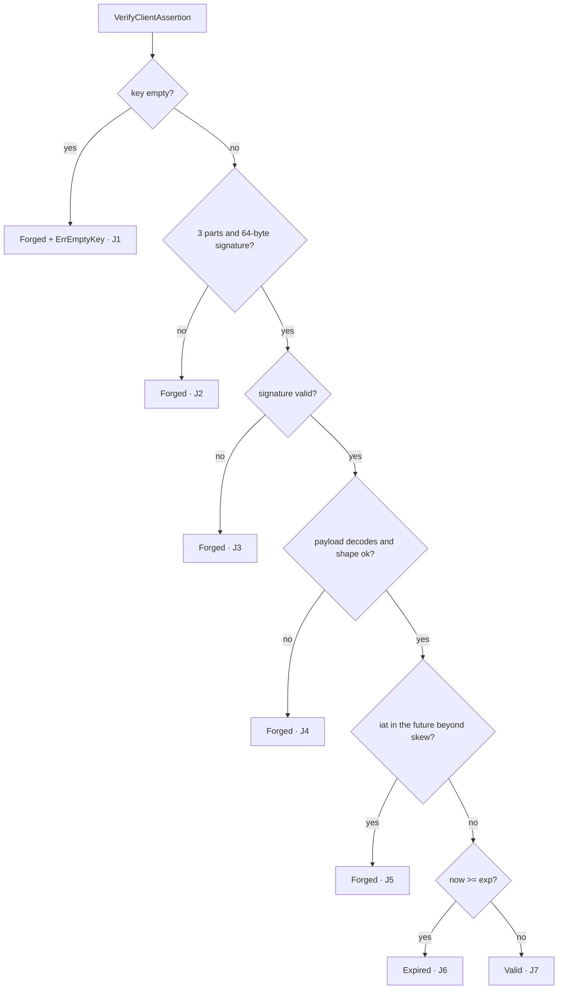

> This plan is dispatched via the CodeJob workflow. See skill: agents-workflow.

# Plan — jwt: client assertions

Read `AGENTS.md` first. Its security invariants apply to everything below,
restated where they matter.

## Why

`veltylabs/iam` authenticates its consumer apps (machine clients). Today a
consumer sends a shared `client_secret` in a JSON body. The replacement is
**`private_key_jwt`** (RFC 7523, the FAPI 2.0 baseline):
- the consumer holds an ECDSA P-256 private key that never leaves it;
- for **every request** it signs a short-lived JWT, the *client assertion*;
- iam verifies that assertion with the consumer's registered public key.

The assertion is bound to the HTTP method and URL (`htm`/`htu`, the same
binding DPoP RFC 9449 uses) and carries a single-use `jti`. Together they
prevent replay and stop an assertion meant for one endpoint from being used
against another.

This library is HS256-only today and deliberately closed. This plan adds a
**second, separate, closed** path: a different claims type and different
functions, ES256 only. It never negotiates the algorithm from the token
header, so the alg-confusion invariant holds for both paths.

## Dependency

`webtyp.com/crypto` must export (added in-session by the planner before
dispatch):

```go
// asym.SignCompact signs SHA-256(message) with an ECDSA P-256 private key (SEC 1
// DER, the format asym.GenerateKeyPair returns) and returns the 64-byte r||s
// signature JWS ES256 uses (RFC 7518 §3.4).
func SignCompact(message, privateKey []byte) ([]byte, error)
// asym.VerifyCompact verifies a 64-byte r||s signature over SHA-256(message)
// with a P-256 public key (PKIX/SPKI DER).
func VerifyCompact(message, signature, publicKey []byte) (bool, error)
```

`go get webtyp.com/crypto@latest`. If `asym.SignCompact` is missing, **stop**.

## Design gate

1. **Prior art.**
   - RFC 7523 §2.2 / §3 defines the client assertion claims (`iss`=`sub`=client id,
     `aud`, `exp`, `jti`).
   - OpenID Connect Core §9 `private_key_jwt` and FAPI 2.0 make it the
     high-assurance client authentication.
   - DPoP (RFC 9449) adds `htm`/`htu` to bind a proof to one request.
   - go-jose and golang-jwt support ES256 with an algorithm whitelist, but
     both take the algorithm from the header and rely on the caller's
     whitelist. Here the function **is** the algorithm, so there is nothing to
     whitelist and nothing to confuse.
2. **Novice names.**
   - `jwt.NewClientAssertion(clientID, audience, method, url)`;
   - `jwt.SignClientAssertion(privateKey, a)`;
   - `jwt.VerifyClientAssertion(publicKey, token)`;
   - `jwt.UnverifiedAssertionIssuer(token)`. The word "Unverified" warns the
     reader in the name itself, like the existing `DecodeUnverified`.
   - Type `jwt.ClientAssertion`. "Client assertion" is the exact RFC 7523 term.
3. **Complexity ledger.**
   - Concepts: +1 (client assertion).
   - Ways to authenticate a machine client in the ecosystem: the
     `client_secret` path is deleted in iam's plan, so the net is 0.
   - Call site in a consumer: one line per request (`New` + `Sign`), wrapped
     once in iam's client package.
4. **Where it belongs.** JWT encoding and verification is this library's only
   concern. ECDSA math stays in `webtyp/crypto/asym`. Who may present which key
   is the consumer's concern (`webtyp/auth/clientassertion` + iam), not this
   library's.
5. **What it deletes.** Nothing here. It enables deleting iam's
   `client_secret` (hashing, pepper, verification, rotation UI).

## Stage 1 — `assertion.go` (new file, package `jwt`)

```go
// ClientAssertion is the claim set of an RFC 7523 client assertion, bound to
// one HTTP request (htm/htu, as in RFC 9449). It is a closed struct, never a
// claims bag (see AGENTS.md).
type ClientAssertion struct {
	Iss string // client id; must equal Sub
	Sub string // client id
	Aud string // the verifier's identifier, e.g. "https://iam.velty.cl"
	Jti string // single-use id; the verifier rejects a repeat
	Htm string // HTTP method of the request this assertion authorizes
	Htu string // absolute URL (no query, no fragment) of that request
	Iat int64  // issued at, unix seconds
	Exp int64  // expiry, unix seconds; Exp-Iat <= MaxAssertionLifetime
}

const (
	// MaxAssertionLifetime bounds Exp-Iat. An assertion authorizes one request
	// made right now; a long-lived one is a replayable credential.
	MaxAssertionLifetime = 60 // seconds
	// AssertionClockSkew tolerates a client clock ahead of the verifier when
	// checking Iat.
	AssertionClockSkew = 30 // seconds
	// minJtiBytes is the entropy NewClientAssertion puts in Jti.
	minJtiBytes = 16
)

var (
	// ErrEmptyKey: caller error, like ErrEmptySecret.
	ErrEmptyKey = fmt.Err("jwt", "key", "empty")
	// ErrIncompleteAssertion: SignClientAssertion refuses to mint an assertion
	// missing any claim, with Iss != Sub, or living longer than MaxAssertionLifetime.
	ErrIncompleteAssertion = fmt.Err("jwt", "client", "assertion", "incomplete")
)

// NewClientAssertion fills Iss=Sub=clientID, Aud, Htm, Htu, Iat=now,
// Exp=now+MaxAssertionLifetime and a random Jti (16 bytes from
// webtyp/crypto/rand, base64url).
func NewClientAssertion(clientID, audience, method, url string) (ClientAssertion, error)

// SignClientAssertion returns an ES256 token. Header is exactly
// {"alg":"ES256","typ":"JWT"}, built inside this function.
func SignClientAssertion(privateKey []byte, a ClientAssertion) (string, error)

// VerifyClientAssertion authenticates an ES256 client assertion with the
// client's P-256 public key (SPKI DER). Same two-channel contract as Verify:
// error = caller broken (empty key); Outcome = what the token is. It never
// reads the header's alg. It does NOT check Aud, Htm, Htu or Jti uniqueness:
// those depend on the request and on storage, and the caller (the
// authenticator) checks them against the request it is serving.
func VerifyClientAssertion(publicKey []byte, token string) (ClientAssertion, Outcome, error)

// UnverifiedAssertionIssuer returns the iss claim WITHOUT verifying anything.
// Its only legitimate use is choosing which public key to verify with; never
// trust the value for anything else. Returns ErrMalformed-style error
// (reuse the package's existing malformed-token error if there is one;
// otherwise add ErrMalformedToken = fmt.Err("jwt", "token", "malformed")).
func UnverifiedAssertionIssuer(token string) (string, error)
```

`ClientAssertion` implements `model.Encodable`/`Decodable` like `Claims` does
(`EncodeFields` writes iss, sub, aud, jti, htm, htu, iat, exp; `DecodeFields`
reads them; `IsNil` returns false).

`VerifyClientAssertion` steps, in this order (see the branch diagram):
1. `len(publicKey) == 0` → `ClientAssertion{}, Forged, ErrEmptyKey`.
2. Split into 3 parts, otherwise `Forged`.
3. base64url-decode the signature. Its length must be 64, otherwise `Forged`.
4. `asym.VerifyCompact([]byte(parts[0]+"."+parts[1]), sig, publicKey)`. Not ok
   or error → `Forged`. (A malformed public key is the caller's
   configuration, but it is per-client data from a database, so it is treated
   as `Forged`, not as an error. Document that in the comment.)
5. Decode the payload. Failure → `Forged`.
6. Shape: `Iss == "" || Iss != Sub || Aud == "" || Jti == "" || Htm == "" || Htu == "" || Iat <= 0 || Exp <= Iat || Exp-Iat > MaxAssertionLifetime` → `Forged`.
7. `Iat > now+AssertionClockSkew` → `Forged` (minted in the future).
8. `now >= Exp` → `Expired`.
9. `Valid`.

`now` comes from the same clock helper `isExpired` uses (do not add a second
clock source).

## Branch diagram



| Branch | Test (`tests/assertion_test.go`, shared stdlib+WASM via the existing `shared_test.go` pattern) |
|---|---|
| J1 | empty key → `ErrEmptyKey`, `Forged` |
| J2 | `"a.b"`; and a token whose signature part decodes to 70 bytes |
| J3 | sign with key A, verify with key B; and flip one payload byte after signing |
| J4 | hand-signed payloads (sign the signing input yourself with `asym.SignCompact` in the test, as `shared_test.go` forges HS256): `iss != sub`; missing `jti`; `exp-iat = 61` |
| J5 | `iat = now+31`, `exp = iat+30` |
| J6 | `iat = now-90`, `exp = now-30` |
| J7 | `NewClientAssertion` + `SignClientAssertion` + `VerifyClientAssertion` round-trip returns the same claims |
| alg confusion | a token whose header says `{"alg":"HS256"}` or `{"alg":"none"}` but is otherwise a valid ES256 signature still verifies **only** as ES256 (header ignored); and an HS256 token from `Sign` is `Forged` here |
| Sign refusals | `SignClientAssertion` with empty key → `ErrEmptyKey`; with `Exp-Iat > 60` or empty `Htu` → `ErrIncompleteAssertion` |
| `NewClientAssertion` | `Jti` decodes to 16 bytes; two calls give different `Jti` |
| `UnverifiedAssertionIssuer` | returns `iss` of a valid token; error on `"x"` |

Generate test keys with `asym.GenerateKeyPair()`.

## Stages

| # | Files | Done when |
|---|---|---|
| 1 | `go.mod`, `go.sum`, `assertion.go` | compiles, native and `GOOS=js GOARCH=wasm` |
| 2 | `tests/assertion_test.go` (+ wiring in the existing stdlib/WASM entry files if that is how this repo runs shared tests) | all rows green |
| 3 | `README.md` (an "I want X → use Y" row: "authenticate a machine client → `NewClientAssertion` + `SignClientAssertion`; verify → `VerifyClientAssertion`"), `AGENTS.md` (invariants: add "ES256 path: the function is the algorithm; header never read; lifetime ≤ 60 s") | docs match |

## Acceptance criteria

- `gotest` green, including the WASM suite. ES256 must work under
  `GOOS=js GOARCH=wasm`, because a Cloudflare Worker verifies these.
- `grep -n "alg" assertion.go` → only the header constant written by
  `SignClientAssertion`. No read of the header's alg anywhere.
- No `map` in `assertion.go`.
- Before opening the PR: `git diff --stat main` lists every file of the
  stages table, and no file is deleted that this plan does not order deleted.
